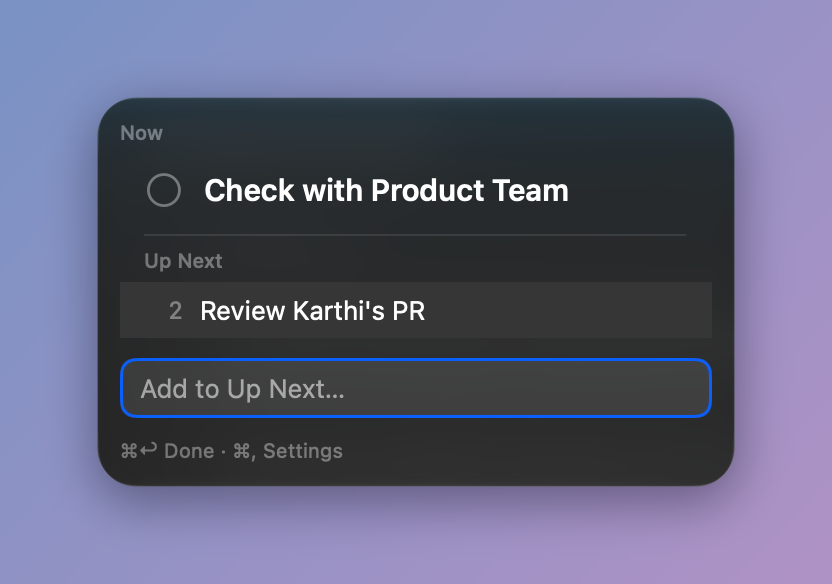

# Wedge

A menu-bar list that shows what you are on now, and keeps the rest in order behind it.



The menu bar shows **Now**, the top item. Everything below it is **Up Next**, in the order you put it. When the Now item is finished, press Done: the next one rises into place.

Wedge is free and open source. It requires **macOS 26 Tahoe** or later.

## Install

1. Download the latest `.zip` or `.dmg` from [Releases](https://github.com/adminALEX/wedge/releases).
2. Move Wedge to Applications and open it. It lives in the menu bar and has no Dock icon.
3. If the menu-bar item is hidden (a crowded bar, or the notch), open Wedge again from Applications or Spotlight. That opens the panel.

## Use

Click the menu-bar item, or press ⌃⌥W, to open the panel. Type and press ↩ to add to Up Next. The first item you add becomes Now. Drag a row to reorder it, or to the top to make it Now. Items are limited to 40 characters.

### Shortcuts

| Where | Keys | Action |
|-------|------|--------|
| Anywhere | ⌃⌥W | Show Wedge |
| Anywhere | ⌃⌥D | Done |
| Panel | ↑ / ↓ | Move selection (↑ from the add field enters the list) |
| Panel | ↩ | Edit the selected row; ↩ again saves |
| Panel | ⌘↩ | Done |
| Panel | ⌫ | Delete the selected row |
| Panel | ⌥⌘↑ / ⌥⌘↓ | Move the selected row up or down |
| Panel | ⌘Z | Undo Done |
| Panel | ⌘, | Settings |
| Panel | Esc | Cancel an edit, otherwise close the panel |
| Menu-bar item | ⌥-click | Done |
| Menu-bar item | Right click | Menu: Done, Undo Done, Settings…, Quit Wedge |

The two global shortcuts can be changed in Settings.

### Shortcuts app and Spotlight

Wedge adds three actions that appear in the Shortcuts app and in Spotlight without setup:

| Action | What it does | Phrase |
|--------|--------------|--------|
| Add to Up Next | Adds the text you give it | "Add to Up Next in Wedge" |
| Mark Done | Finishes the Now item | "Mark Done in Wedge" |
| Get Now | Returns the text of the Now item | "What's Now in Wedge" |

## Privacy

Wedge has no network access, no analytics and no update check. Your list never leaves your Mac. It is stored in Wedge's sandboxed app container, in one file:

`~/Library/Containers/com.xela.wedge/Data/Library/Application Support/Wedge/wedge.json`

## Build from source

You need Xcode 26 or later on macOS 26 or later.

1. Open `wedge.xcodeproj` in Xcode.
2. Select the `wedge` scheme and run.

From the command line:

```bash
# Unit tests
xcodebuild test -scheme wedge -destination 'platform=macOS' -only-testing:wedgeTests

# UI tests
xcodebuild test -scheme wedge -destination 'platform=macOS' -only-testing:wedgeUITests

# Formatting
xcrun swift-format lint -r --strict wedge wedgeTests wedgeUITests
```

### Continuous integration

Every push runs the format check and the unit tests on GitHub Actions. UI tests are slower and run only when asked: start the workflow by hand from the Actions tab (workflow_dispatch), or put `[ui-tests]` in the head commit's message.

## Project

- [Product overview](docs/product/overview.md)
- [Roadmap](docs/product/roadmap.md)
- [Design spec](docs/superpowers/specs/2026-11-01-wedge-1.0-redesign-design.md)

Wedge stays focused by default. Bug fixes and polish are welcome; a new feature needs a short design doc first (see the overview).
